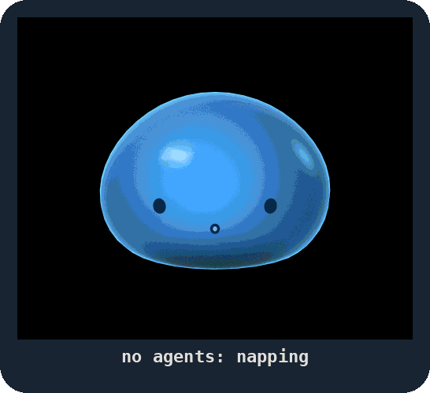
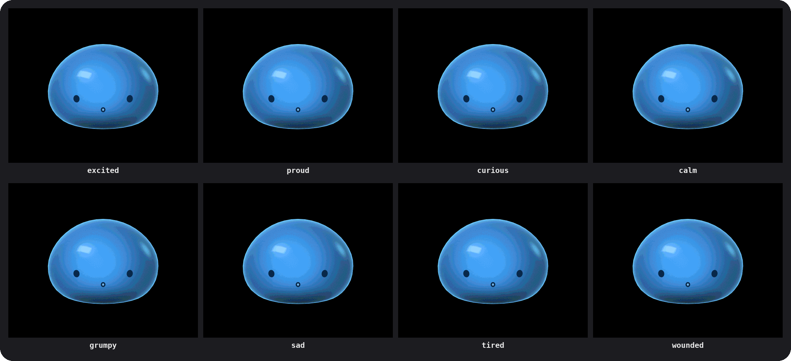

<p align="center">
  
</p>

<h1 align="center">SlimeBuddy</h1>

<p align="center">
  <b>A little gel slime for your desk that keeps an eye on your AI coding agents.</b>
</p>

<p align="center">
  
  
  
  
</p>

You've got three Claude sessions and two Codex threads going, and one of
them has been waiting on you for ten minutes. The slime noticed. It's
been glowing amber about it.

## Meet the slime

A soft, blue, softly glowing blob that lives on a 2-inch AMOLED screen
beside your keyboard. It's Boop's own character: overconfident,
theatrical, easily wounded and secretly a bit needy. A tiny dramatic
coworker who keeps doing the job while it tells you how it feels about
every turn your agents take.

- 💤 **Naps** while no agent is open. Idle, it blows bubbles, reads and counts sheep.
- ⌨️ **Works along** while they do: every command an agent runs falls
  past it as a word, and some of them hit it. On a long stretch it sips
  its coffee, puts its headphones on and writes itself a sticky note.
- 🟧 **Glows amber and knocks** when an agent needs your approval, and
  says who. Hold a finger on it to put the request away.
- 🏆 **Celebrates** a finish that earns it, bigger the longer the work,
  and grumbles at a failed test. Never at you.
- 👉 **Feels your touch.** Stroke it and it calms down, rub it the wrong
  way and it ruffles, boop it and it's tickled, shake it and it gets dizzy.
  Hold its button and talk to it: it answers.
- 📔 **Keeps a diary**, a line a day about the one before, and dresses for
  the day: coffee in the morning, a nightcap at night, a costume on
  Halloween.

It's cheeky: it teases the agents and the work, never you, and it's
always on your side. It has moods of its own, 42 of them, and there's no
reset button. It only watches: it never approves, denies or blocks
anything an agent does.

<p align="center">
  
</p>

A menu-bar app on your Mac does the thinking; the board is its body. The
slime is in the menu bar's popover too: the board's own firmware, running
on your Mac, beside every session and what it's doing.

> **Would you like a ready-made one?** The software is free and stays MIT.
> If you'd rather not flash a board yourself,
> [let us know →](https://tally.so/r/ZjprM5?src=slimebuddy)

## Get started

### What you need

| You need | Why |
| --- | --- |
| 💻 **A Mac** | macOS 15 or later, with Command Line Tools 26 or later (`xcode-select --install`): Swift 6.2 and the macOS 26 SDK |
| 🐍 **A newer Python** | For flashing the board, unless you already have PlatformIO's `pio`: `brew install python`. PlatformIO installs itself |
| 🟦 **The board** | A Waveshare **ESP32-S3-Touch-AMOLED-2.06**: a 2.06" AMOLED, 410×502, with capacitive touch. And a USB-C cable that carries data |
| 💾 **A microSD card** | Optional, for the slime's voice: copy `character/voice/voice.bin` onto a FAT32 card as `boop/voice.bin`. Without one it's silent, and its faces work the same |
| 🔑 **A Jev key** | Optional. [Jev](https://docs.typesafe.ai/api) is TypeSafe's small hosted model, and it's what picks the slime's reactions. Without a key, it still shows what your agents are doing and when you're needed, but doesn't react or celebrate. Add it in Settings |

### Three steps

Clone this repository with its submodules, and run everything from its
folder:

```sh
git clone --recurse-submodules https://github.com/Mellow-Machines-Lab/SlimeBuddy.git && cd SlimeBuddy
```

1. **Flash it.** Plug the board in over USB and run `make flash`. The
   first time, it installs PlatformIO and the ESP32 toolchain, which
   takes a few minutes.
2. **Run it.** From your own terminal, run `make bundle`, then
   `open Boop.app`. The first build takes a few minutes, then the slime
   says hello in a window of its own.
3. **Meet it.** It walks you through what it does, gets a name, finds
   its body on your desk (tap its screen when it asks), shows you how to
   use it, and connects your agents. Then it lives in the menu bar.
   Restart open agent sessions so they pick up its hooks.

Then tap the screen to poke it. Press BOOT while an agent waits for you
and it opens that agent on the Mac.

### Everyday commands

| To | Run |
| --- | --- |
| Flash the firmware (over USB) | `make flash` |
| Build `Boop.app`, to open from Finder or put in Applications | `make bundle` (then `open Boop.app`) |
| Play one of its demos in the simulator, in a browser, no board needed | `make demo` (it asks which; `NAME=talk-back` plays that one) |
| Work on it: the debug app, the simulator, the studio and the live dashboard | `make dev` |

Run `make bundle` and `make dev` from your own terminal: macOS stops
anything that uses Bluetooth from an editor's or an agent's shell.

## What leaves your Mac

Nothing, unless you add a Jev key. With one, the slime sends TypeSafe a
short text each time it thinks: what's been happening, in lines like
`claude started turn 1 on "landing".`, and its personality and mood.
Your files, commands and tool output never go.
[Boop's README](https://github.com/Mellow-Machines-Lab/buddygotchi#what-leaves-your-mac)
has the whole list.

## How it's made

Everything that makes the slime the slime is in `character/`, its
character pack:

| Folder | What it is |
| --- | --- |
| `steering/` | Who it is, for the brain: its personality, how it reads what happens, and how each mood acts |
| `design/slime-blob/` | Its design as data: moods, faces, acting, scenes and sounds ([start here](character/design/slime-blob/README.md), [how it moves](character/design/slime-blob/CONTINUITY.md)) |
| `firmware/src/render/gel/` | The gel engine, C++ that shades the slime every frame on the board, in the simulator and in the Mac's popover |
| `tools/slimegen/` | Bakes the design into the engine's tables (`make slime`) |
| `design/assets/boop-voice-v1/`, `tools/voicegen/` | Its recorded voice, and what builds the card's voice file (`make voice`) |
| `rig/`, `demo/`, `evals/`, `tests/` | Its moves, its demos, the brain's eval scenarios and its goldens |

`engine/` is [Boop](https://github.com/Mellow-Machines-Lab/buddygotchi),
the engine every character runs on: the Mac app, the board's firmware,
the brain and the device link. `make check` runs all its checks with
the slime.

## Other characters

- **[PixelBuddy](https://github.com/Mellow-Machines-Lab/PixelBuddy)**:
  Pixel, a pixel-art face on the Cheap Yellow Display.
- **Your own.** A character is a folder of files:
  [CHARACTER.md](https://github.com/Mellow-Machines-Lab/buddygotchi/blob/main/characters/CHARACTER.md)
  says what goes in one.

## Licence

MIT, as Boop is ([LICENSE](LICENSE)). Its fonts and libraries are listed
in Boop's
[THIRD_PARTY_NOTICES.md](https://github.com/Mellow-Machines-Lab/buddygotchi/blob/main/THIRD_PARTY_NOTICES.md).
